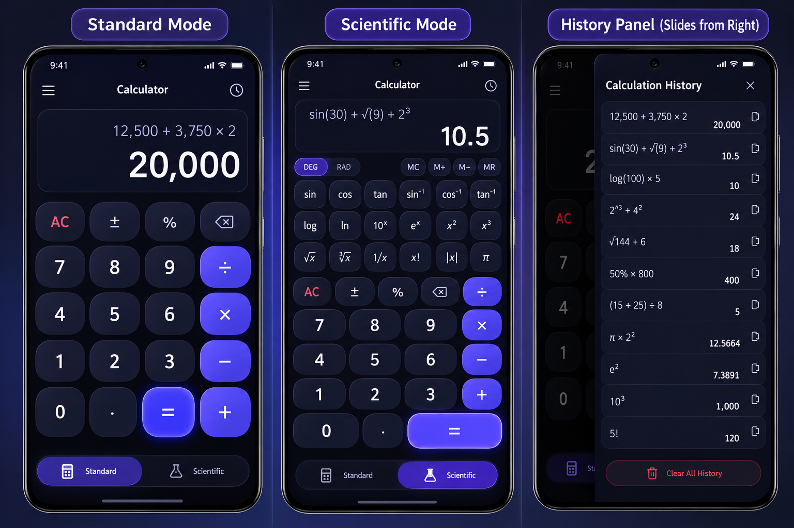
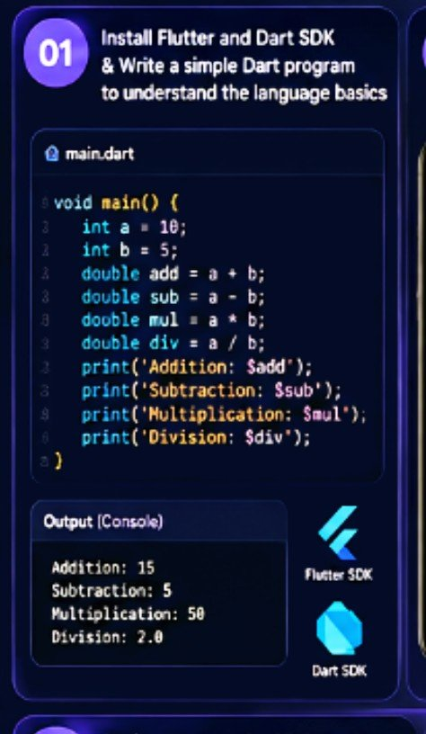
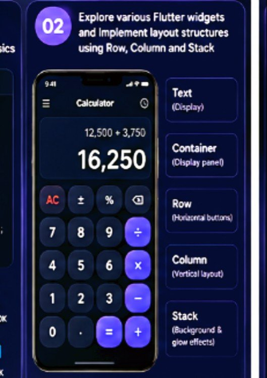
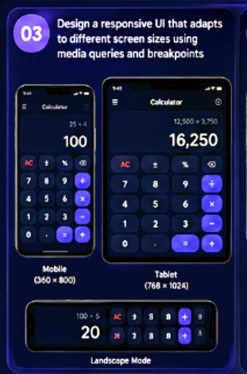
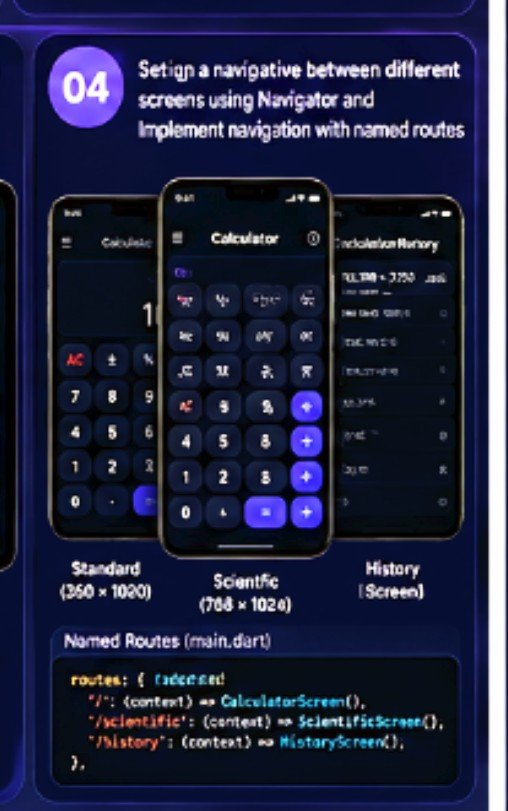
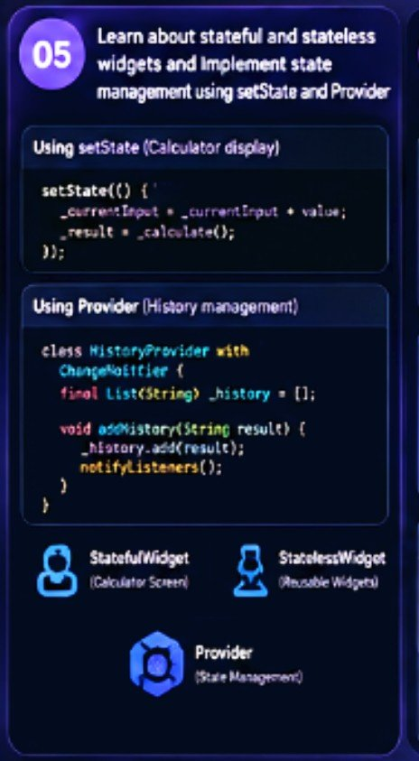
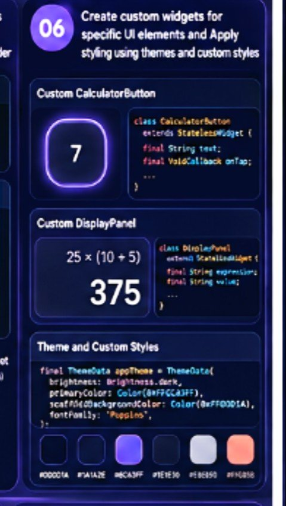
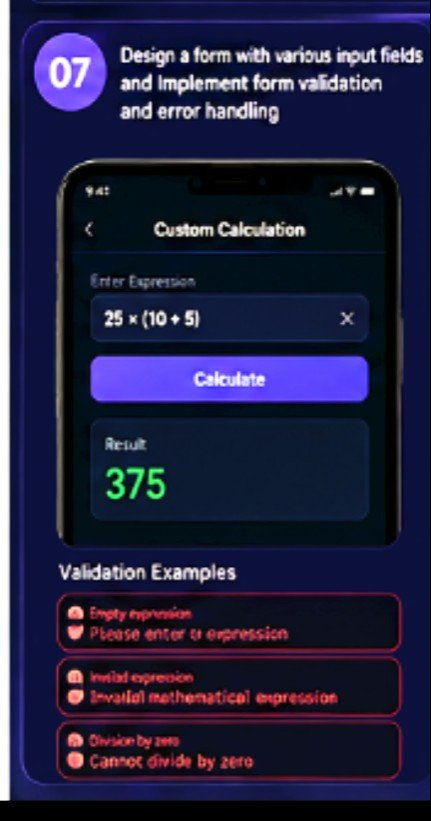
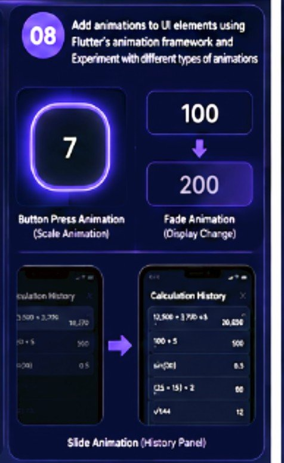
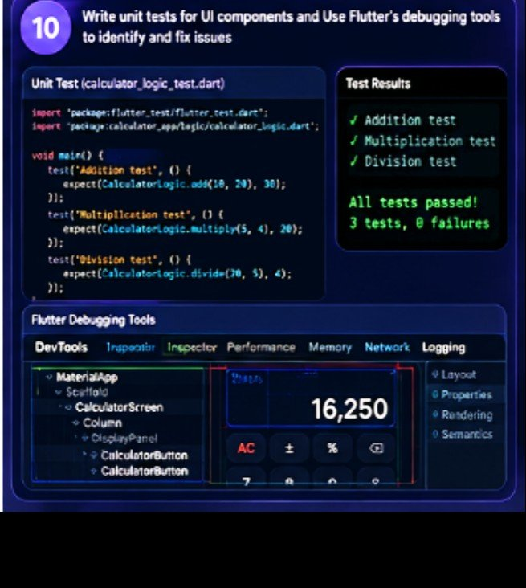

# 🧮 Flutter & Dart Laboratory — Calculator App & Lab Record

A complete mobile application development laboratory portfolio implemented through a feature-packed **Scientific Calculator & Currency Converter** application built with **Flutter and Dart**.

---

## 📱 Project Preview

<p align="center">
  
</p>

<p align="center">
  <b>Standard Mode (4×5 Grid)</b> &nbsp;•&nbsp; <b>Scientific Mode (Extended Functions)</b> &nbsp;•&nbsp; <b>Slide-In History Panel</b>
</p>

---

## 📑 Table of Contents

- [Flutter Lab Experiment Mapping](#-flutter-lab-experiment-mapping)
- [Experiment 1: Setup & Dart Basics](#experiment-1-setup--dart-language-fundamentals)
  - [1(a) Install Flutter and Dart SDK](#1a-install-flutter-and-dart-sdk)
  - [1(b) Dart Language Basics](#1b-write-a-simple-dart-program-to-understand-the-language-basics)
- [Experiment 2: Widgets & Layout Architecture](#experiment-2-widgets--layout-architecture)
  - [2(a) Explore Core Flutter Widgets](#2a-explore-various-flutter-widgets-text-image-container-etc)
  - [2(b) Layout Structures with Row, Column, and Stack](#2b-implement-different-layout-structures-using-row-column-and-stack-widgets)
- [Experiment 3: Responsive & Adaptive Design](#experiment-3-responsive--adaptive-design)
  - [3(a) Design a Responsive UI](#3a-design-a-responsive-ui-that-adapts-to-different-screen-sizes)
  - [3(b) Media Queries & Breakpoints](#3b-implement-media-queries-and-breakpoints-for-responsiveness)
- [Experiment 4: Navigation & Routing](#experiment-4-navigation--routing)
  - [4(a) Screen Navigation using Navigator](#4a-set-up-navigation-between-different-screens-using-navigator)
  - [4(b) Navigation with Named Routes](#4b-implement-navigation-with-named-routes)
- [Experiment 5: Widget State & State Management](#experiment-5-widget-state--state-management)
  - [5(a) Stateful vs Stateless Widgets](#5a-learn-about-stateful-and-stateless-widgets)
  - [5(b) State Management with setState & Provider](#5b-implement-state-management-using-setstate-and-provider)
- [Experiment 6: Custom Components & UI Theming](#experiment-6-custom-components--ui-theming)
  - [6(a) Reusable Custom Widgets](#6a-create-custom-widgets-for-specific-ui-elements)
  - [6(b) Themes and Custom Styling](#6b-apply-styling-using-themes-and-custom-styles)
- [Experiment 7: User Input & Form Validation](#experiment-7-user-input--form-validation)
  - [7(a) Form with Input Fields](#7a-design-a-form-with-various-input-fields)
  - [7(b) Form Validation & Error Handling](#7b-implement-form-validation-and-error-handling)
- [Experiment 8: Animation & Motion Framework](#experiment-8-animation--motion-framework)
  - [8(a) UI Elements with Flutter Animation Framework](#8a-add-animations-to-ui-elements-using-flutters-animation-framework)
  - [8(b) Experimenting with Animation Types (Scale, Fade, Slide)](#8b-experiment-with-different-types-of-animations-fade-slide-etc)
- [Experiment 9: REST API Integration & Data Display](#experiment-9-rest-api-integration--data-display)
  - [9(a) Fetching Data from a REST API](#9a-fetch-data-from-a-rest-api)
  - [9(b) Displaying Fetched Data in the UI](#9b-display-the-fetched-data-in-a-meaningful-way-in-the-ui)
- [Experiment 10: Testing & Debugging Tools](#experiment-10-testing--debugging-tools)
  - [10(a) Unit Testing UI Components & Logic](#10a-write-unit-tests-for-ui-components)
  - [10(b) Flutter DevTools & Widget Inspector](#10b-use-flutters-debugging-tools-to-identify-and-fix-issues)
- [✨ Calculator Features & Modes](#-calculator-features--modes)
- [🚀 Getting Started](#-getting-started)

---

## 🧪 Flutter Lab Experiment Mapping

| Exp | Lab Objective | Implementation in Calculator Project | Screenshot Reference |
|:---:|:---|:---|:---:|
| **01** | Install SDK & Dart Basics | Environment verification & Dart calculation logic | [View Image](#📸-calculator-screenshot-1) |
| **02** | Explore Widgets & Layouts | Display panel (`Container`), buttons (`Row`/`Column`), glow (`Stack`) | [View Image](#📸-calculator-screenshot-2) |
| **03** | Responsive UI & Media Queries | Mobile ($360\times800$), Tablet ($768\times1024$), Landscape mode | [View Image](#📸-calculator-screenshot-3) |
| **04** | Screen Navigation & Named Routes | Standard (`/`), Scientific (`/scientific`), History (`/history`) | [View Image](#📸-calculator-screenshot-4) |
| **05** | Stateful Widgets & Provider State | Interactive display (`setState`), calculation history (`Provider`) | [View Image](#📸-calculator-screenshot-5) |
| **06** | Custom Widgets & Dark Theming | `CalculatorButton`, `DisplayPanel`, `#0D0D1A` Indigo palette | [View Image](#📸-calculator-screenshot-6) |
| **07** | Forms & Input Validation | Custom calculation form, syntax & divide-by-zero checks | [View Image](#📸-calculator-screenshot-7) |
| **08** | Flutter Animations (Fade, Slide) | Button press scale, display fade, history panel slide-in | [View Image](#📸-calculator-screenshot-8) |
| **09** | REST API & Async Data Display | Live exchange rate API fetching & Currency Converter UI | [View Image](#📸-calculator-screenshot-9) |
| **10** | Unit Testing & Debugging Tools | `calculator_logic_test.dart` & Flutter DevTools Widget Inspector | [View Image](#📸-calculator-screenshot-10) |

---

## Experiment 1: Setup & Dart Language Fundamentals

### 1(a) Install Flutter and Dart SDK
#### 🎯 Aim
To install, configure, and verify the Flutter and Dart SDK environment on the operating system using command-line diagnostic tools.

```bash
# Verify installation and toolchains
flutter doctor -v
```

### 1(b) Write a simple Dart program to understand the language basics
#### 🎯 Aim
To implement fundamental arithmetic calculation logic using Dart variables, types, and functions.

```dart
void main() {
  int a = 10;
  int b = 5;
  double add = (a + b).toDouble();
  double sub = (a - b).toDouble();
  double mul = (a * b).toDouble();
  double div = a / b;

  print('Addition: $add');
  print('Subtraction: $sub');
  print('Multiplication: $mul');
  print('Division: $div');
}
```

#### 📸 Calculator Screenshot 1
<p align="center">
  
</p>

---

## Experiment 2: Widgets & Layout Architecture

### 2(a) Explore various Flutter widgets (Text, Image, Container, etc.)
#### 🎯 Aim
To build a clean calculator user interface using essential Flutter primitives: `Text` for display outputs, `Container` with rounded borders for display panels, and `Icon` for action buttons.

### 2(b) Implement different layout structures using Row, Column, and Stack widgets
#### 🎯 Aim
To structure the calculator layout using:
- **`Column`**: Vertically sequences the top status bar, expression display panel, and keypad.
- **`Row`**: Horizontally spaces arithmetic buttons across four columns.
- **`Stack`**: Overlays glowing gradient backdrops behind active operator buttons and slide-in panels.

```dart
Widget buildCalculatorKeypad() {
  return Column(
    children: [
      Row(
        mainAxisAlignment: MainAxisAlignment.spaceEvenly,
        children: [
          CalculatorButton(text: '7', onTap: () => append('7')),
          CalculatorButton(text: '8', onTap: () => append('8')),
          CalculatorButton(text: '9', onTap: () => append('9')),
          CalculatorButton(text: '÷', isOperator: true, onTap: () => setOp('÷')),
        ],
      ),
      // Additional Rows for keypad...
    ],
  );
}
```

#### 📸 Calculator Screenshot 2
<p align="center">
  
</p>

---

## Experiment 3: Responsive & Adaptive Design

### 3(a) Design a responsive UI that adapts to different screen sizes
#### 🎯 Aim
To implement an adaptive calculator layout that dynamically scales on compact phones, tablets, and wide screens.

### 3(b) Implement media queries and breakpoints for responsiveness
#### 🎯 Aim
To query viewport dimensions using `MediaQuery.of(context)` and adjust keypad grids and aspect ratios across:
- **Mobile Mode**: $360 \times 800$ portrait phone layout.
- **Tablet Mode**: $768 \times 1024$ expanded screen layout.
- **Landscape Mode**: Dual-column layout placing the scientific pad alongside standard controls.

```dart
Widget build(BuildContext context) {
  final isLandscape = MediaQuery.of(context).orientation == Orientation.landscape;
  final screenWidth = MediaQuery.of(context).size.width;

  if (isLandscape) {
    return buildLandscapeCalculator(); // 2-row / wide grid
  } else if (screenWidth > 600) {
    return buildTabletCalculator();    // Proportional tablet view
  } else {
    return buildMobileCalculator();    // Classic standard grid
  }
}
```

#### 📸 Calculator Screenshot 3
<p align="center">
  
</p>

---

## Experiment 4: Navigation & Routing

### 4(a) Set up navigation between different screens using Navigator
#### 🎯 Aim
To enable seamless transitions between the **Standard Calculator**, **Scientific Calculator**, and **Calculation History** screens using `Navigator.push()` and `Navigator.pop()`.

### 4(b) Implement navigation with named routes
#### 🎯 Aim
To declare centralized route definitions in `MaterialApp` using named paths.

```dart
// main.dart route configuration
MaterialApp(
  initialRoute: '/',
  routes: {
    '/': (context) => const CalculatorScreen(),
    '/scientific': (context) => const ScientificScreen(),
    '/history': (context) => const HistoryScreen(),
  },
);

// Navigation action
Navigator.pushNamed(context, '/scientific');
```

#### 📸 Calculator Screenshot 4
<p align="center">
  
</p>

---

## Experiment 5: Widget State & State Management

### 5(a) Learn about stateful and stateless widgets
#### 🎯 Aim
To distinguish between immutable presenter widgets (`StatelessWidget` for reusable keys) and mutable state holders (`StatefulWidget` for dynamic expression entry).

### 5(b) Implement state management using setState and Provider
#### 🎯 Aim
- **Local State (`setState`)**: Updates current operand input, decimal formatting, and live calculation preview on every key tap.
- **Global State (`Provider`)**: `HistoryProvider` extends `ChangeNotifier` to maintain past operations and broadcast updates to the slide-in history drawer.

```dart
// 1. Local State update
setState(() {
  _currentInput += value;
  _result = _calculate();
});

// 2. Centralized Provider for calculation history
class HistoryProvider with ChangeNotifier {
  final List<String> _history = [];
  List<String> get history => _history;

  void addHistory(String entry) {
    _history.add(entry);
    notifyListeners();
  }
}
```

#### 📸 Calculator Screenshot 5
<p align="center">
  
</p>

---

## Experiment 6: Custom Components & UI Theming

### 6(a) Create custom widgets for specific UI elements
#### 🎯 Aim
To create modular, custom components including `CalculatorButton` (with custom ripple & glow properties) and `DisplayPanel` (auto-fitting expression renderer).

### 6(b) Apply styling using themes and custom styles
#### 🎯 Aim
To establish an application-wide dark design language using `ThemeData` with custom Poppins typography and a palette:

| Element | Color Name | Hex Code |
|---|---|---|
| Background | Deep Navy | `#0D0D1A` |
| Surface | Dark Blue | `#1A1A2E` |
| Primary Accent | Vivid Indigo | `#6C63FF` |
| Number Buttons | Dark Slate | `#1E1E30` |
| Primary Text | Off-white | `#E8E8F0` |
| Operator Glow | Coral Red | `#FF6B6B` |

```dart
final ThemeData appTheme = ThemeData(
  brightness: Brightness.dark,
  primaryColor: const Color(0xFF6C63FF),
  scaffoldBackgroundColor: const Color(0xFF0D0D1A),
  fontFamily: 'Poppins',
);
```

#### 📸 Calculator Screenshot 6
<p align="center">
  
</p>

---

## Experiment 7: User Input & Form Validation

### 7(a) Design a form with various input fields
#### 🎯 Aim
To create a **Custom Calculation** screen featuring a stylized `TextFormField` where users can type complex nested expressions e.g. `25 × (10 + 5)`.

### 7(b) Implement form validation and error handling
#### 🎯 Aim
To perform validation checks on user input before evaluation:
- ❌ **Empty expression**: *"Please enter an expression"*
- ❌ **Invalid syntax**: *"Invalid mathematical expression"*
- ❌ **Division by zero**: *"Cannot divide by zero"*

```dart
String? validateExpression(String? value) {
  if (value == null || value.trim().isEmpty) {
    return 'Please enter an expression';
  }
  if (value.contains('/0')) {
    return 'Cannot divide by zero';
  }
  return null;
}
```

#### 📸 Calculator Screenshot 7
<p align="center">
  
</p>

---

## Experiment 8: Animation & Motion Framework

### 8(a) Add animations to UI elements using Flutter's animation framework
#### 🎯 Aim
To enrich interactive feedback using Flutter's motion framework:
- **Button Press Animation**: `ScaleTransition` shrinks button to $0.92\times$ on press.
- **Display Change Animation**: `FadeTransition` fades evaluated results smoothly.

### 8(b) Experiment with different types of animations (fade, slide, etc.)
#### 🎯 Aim
To implement a sliding drawer transition for the **History Panel** using `SlideTransition` with `Curves.easeInOutCubic`.

```dart
// Slide Animation for History Drawer
SlideTransition(
  position: Tween<Offset>(
    begin: const Offset(1.0, 0.0), // Starts off-screen right
    end: Offset.zero,              // Slides into view
  ).animate(CurvedAnimation(parent: _drawerController, curve: Curves.easeInOut)),
  child: const HistoryPanel(),
);
```

#### 📸 Calculator Screenshot 8
<p align="center">
  
</p>

---

## Experiment 9: REST API Integration & Data Display

### 9(a) Fetch data from a REST API
#### 🎯 Aim
To integrate a live Currency Converter fetching foreign exchange rates from `https://api.exchangerate-api.com/v4/latest/USD` using the `http` package and JSON decoding.

```dart
// currency_api_service.dart
Future<double> fetchExchangeRate(String from, String to) async {
  final url = 'https://api.exchangerate-api.com/v4/latest/$from';
  final response = await http.get(Uri.parse(url));

  if (response.statusCode == 200) {
    final data = jsonDecode(response.body);
    return (data['rates'][to] as num).toDouble();
  }
  throw Exception('Failed to load currency rate');
}
```

### 9(b) Display the fetched data in a meaningful way in the UI
#### 🎯 Aim
To render live conversion cards showing converted sums (`₹ 8,500.00`) and live rate tags with loading spinners and error fallbacks.

#### 📸 Calculator Screenshot 9
<p align="center">
  
</p>

---

## Experiment 10: Testing & Debugging Tools

### 10(a) Write unit tests for UI components
#### 🎯 Aim
To verify arithmetic operations through automated unit tests in `calculator_logic_test.dart` (Addition, Multiplication, Division).

```dart
test('Addition test', () {
  expect(CalculatorLogic.add(10, 20), 30);
});

test('Multiplication test', () {
  expect(CalculatorLogic.multiply(5, 4), 20);
});

test('Division test', () {
  expect(CalculatorLogic.divide(20, 5), 4);
});
```

### 10(b) Use Flutter's debugging tools to identify and fix issues
#### 🎯 Aim
To inspect widget trees, layout bounds, and repaint boundaries using **Flutter DevTools** and the **Flutter Inspector**.

#### 📸 Calculator Screenshot 10
<p align="center">
  
</p>

---

## ✨ Calculator Features & Modes

### 1. Standard Calculator
- Operations: ➕ Addition, ➖ Subtraction, ✖️ Multiplication, ➗ Division.
- Functions: `%` Percentage, `±` Sign Toggle, `⌫` Backspace, `AC` All Clear.
- Auto-scaling display text with thousand separators.

### 2. Scientific Calculator
- **Trigonometry**: $\sin, \cos, \tan, \sin^{-1}, \cos^{-1}, \tan^{-1}$ (in DEG or RAD).
- **Logarithms**: $\log_{10}(x)$, $\ln(x)$.
- **Powers & Roots**: $x^2, x^3, e^x, 10^x, \sqrt{x}, \sqrt[3]{x}$.
- **Constants**: $\pi$ (3.14159...), $e$ (2.71828...).
- **Special Functions**: $x!$ (Factorial), $1/x$ (Reciprocal), $|x|$ (Absolute value).

### 3. Calculation History
- Stores up to 50 previous expressions and answers.
- Re-use or copy results with one tap.
- Slide-in overlay from right.

### 4. Currency Converter
- Live exchange rates fetched from REST API.
- Instant conversion between USD, INR, EUR, GBP, and more.

---

## 🚀 Getting Started

### Prerequisites
- [Flutter SDK](https://docs.flutter.dev/get-started/install) ($\ge 3.0.0$)
- Dart SDK (bundled with Flutter)
- VS Code or Android Studio

### Installation & Run

```bash
# 1. Clone repository
git clone https://github.com/jaswanthsam54/Flutter-Lab.git

# 2. Enter project folder
cd "Flutter-Lab/calculator_app"

# 3. Fetch dependencies
flutter pub get

# 4. Run application
flutter run
```

### Run Tests & Verification

```bash
# Run unit tests
flutter test

# Run code analysis
flutter analyze
```

---

*Built with ❤️ using Flutter & Dart*
