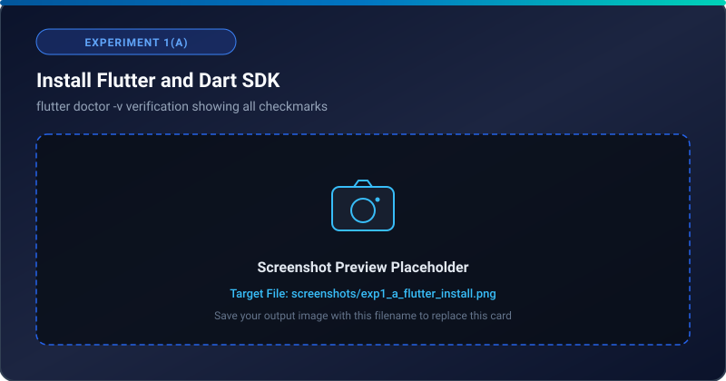
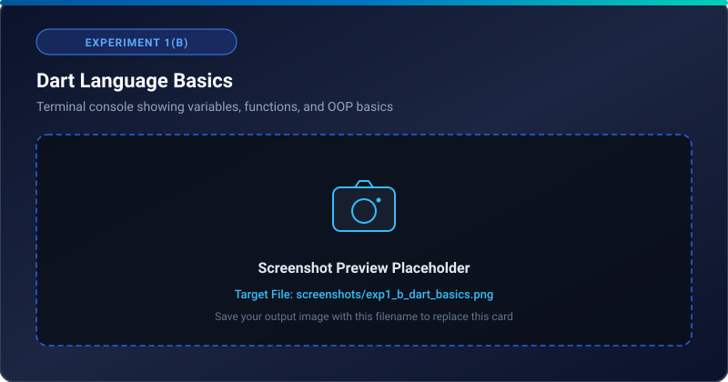
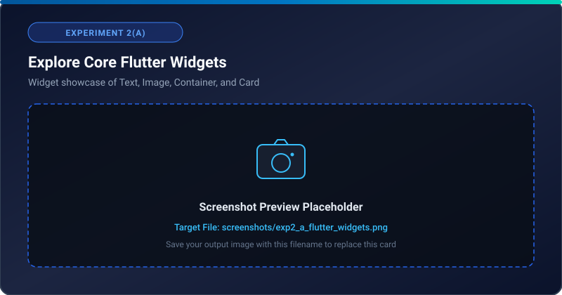
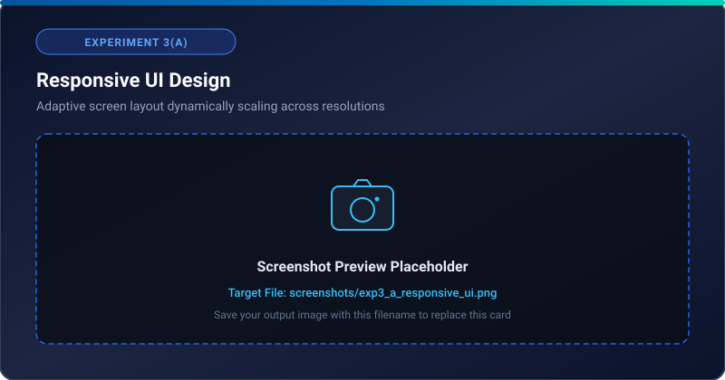
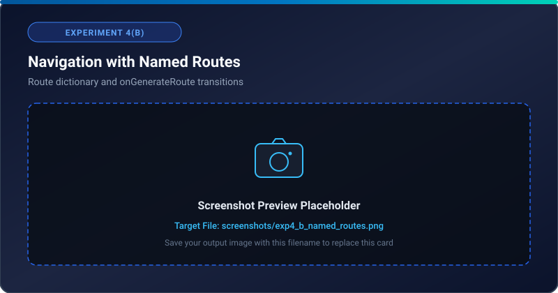
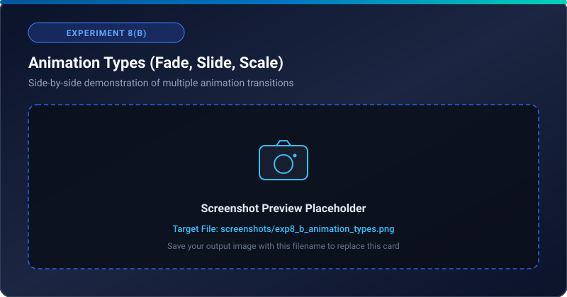
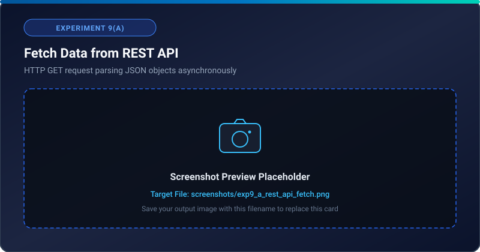
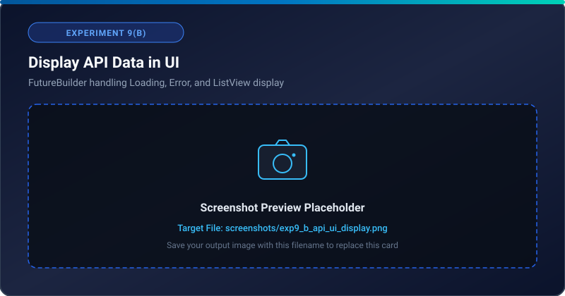

# 📱 Flutter & Dart Development Laboratory

Comprehensive laboratory portfolio covering fundamental to advanced mobile and cross-platform app development using **Flutter** and **Dart**.

---

## 📑 Table of Contents

- [Experiment 1: Environment Setup & Language Fundamentals](#experiment-1-environment-setup--language-fundamentals)
  - [1(a) Install Flutter and Dart SDK](#1a-install-flutter-and-dart-sdk)
  - [1(b) Dart Language Basics](#1b-write-a-simple-dart-program-to-understand-the-language-basics)
- [Experiment 2: Widgets & Layout Architecture](#experiment-2-widgets--layout-architecture)
  - [2(a) Explore Core Flutter Widgets](#2a-explore-various-flutter-widgets-text-image-container-etc)
  - [2(b) Layouts using Row, Column, and Stack](#2b-implement-different-layout-structures-using-row-column-and-stack-widgets)
- [Experiment 3: Responsive & Adaptive Design](#experiment-3-responsive--adaptive-design)
  - [3(a) Design a Responsive UI](#3a-design-a-responsive-ui-that-adapts-to-different-screen-sizes)
  - [3(b) Media Queries & Breakpoints](#3b-implement-media-queries-and-breakpoints-for-responsiveness)
- [Experiment 4: Navigation & Routing](#experiment-4-navigation--routing)
  - [4(a) Screen Navigation with Navigator](#4a-set-up-navigation-between-different-screens-using-navigator)
  - [4(b) Navigation with Named Routes](#4b-implement-navigation-with-named-routes)
- [Experiment 5: Widget State & State Management](#experiment-5-widget-state--state-management)
  - [5(a) Stateful vs Stateless Widgets](#5a-learn-about-stateful-and-stateless-widgets)
  - [5(b) State Management with setState & Provider](#5b-implement-state-management-using-setstate-and-provider)
- [Experiment 6: Custom Components & UI Theming](#experiment-6-custom-components--ui-theming)
  - [6(a) Reusable Custom Widgets](#6a-create-custom-widgets-for-specific-ui-elements)
  - [6(b) Theming & Custom Styling](#6b-apply-styling-using-themes-and-custom-styles)
- [Experiment 7: User Input & Form Validation](#experiment-7-user-input--form-validation)
  - [7(a) Form with Various Input Fields](#7a-design-a-form-with-various-input-fields)
  - [7(b) Form Validation & Error Handling](#7b-implement-form-validation-and-error-handling)
- [Experiment 8: Animation & Motion Design](#experiment-8-animation--motion-design)
  - [8(a) Flutter Animation Framework](#8a-add-animations-to-ui-elements-using-flutters-animation-framework)
  - [8(b) Animation Transitions (Fade, Slide, Scale)](#8b-experiment-with-different-types-of-animations-fade-slide-etc)
- [Experiment 9: REST API Integration & Data Presentation](#experiment-9-rest-api-integration--data-presentation)
  - [9(a) Fetching Data from a REST API](#9a-fetch-data-from-a-rest-api)
  - [9(b) UI Presentation with FutureBuilder](#9b-display-the-fetched-data-in-a-meaningful-way-in-the-ui)
- [Featured Application: Scientific Calculator App](#-featured-application-calculator-app)

---

## Experiment 1: Environment Setup & Language Fundamentals

### 1(a) Install Flutter and Dart SDK

#### 🎯 Aim
To install, configure, and verify the Flutter and Dart SDK development environment on the local operating system.

#### 📝 Description
Flutter is Google's open-source UI software development kit. Installing Flutter also installs the bundled Dart SDK. Environment variables (`PATH`) are configured, and `flutter doctor` is run to ensure Android toolchains, Chrome, and IDE plugins are operational.

```bash
# Verify installation and dependencies
flutter doctor -v
```

#### 📸 Output / Screenshot
<p align="center">
  
</p>

---

### 1(b) Write a simple Dart program to understand the language basics

#### 🎯 Aim
To understand fundamental Dart programming concepts: variables, data types, null safety, collections, and control flow.

#### 📝 Code Example
```dart
void main() {
  // Variables & Data Types
  String course = 'Flutter Mobile Development';
  int labNumber = 1;
  double version = 3.24;
  bool isAwesome = true;

  // Collections
  List<String> topics = ['Widgets', 'Layouts', 'State', 'APIs'];
  Map<String, dynamic> student = {'name': 'Student', 'id': 'FL101'};

  print('Course: $course | Lab: $labNumber (v$version)');
  print('Topics to cover: ${topics.join(", ")}');

  // Control Flow & Functions
  for (var topic in topics) {
    describeTopic(topic);
  }
}

void describeTopic(String topic) => print('-> Mastering: $topic');
```

#### 📸 Output / Screenshot
<p align="center">
  
</p>

---

## Experiment 2: Widgets & Layout Architecture

### 2(a) Explore various Flutter widgets (Text, Image, Container, etc.)

#### 🎯 Aim
To build UI layouts by exploring primitive Flutter widgets including `Text`, `Image`, `Container`, `Icon`, and `Card`.

#### 📝 Code Example
```dart
Widget buildWidgetShowcase() {
  return Card(
    elevation: 4,
    shape: RoundedRectangleBorder(borderRadius: BorderRadius.circular(16)),
    child: Container(
      padding: const EdgeInsets.all(16),
      decoration: BoxDecoration(
        color: Colors.blueGrey.shade50,
        borderRadius: BorderRadius.circular(16),
      ),
      child: Column(
        mainAxisSize: MainAxisSize.min,
        children: [
          const Icon(Icons.flutter_dash, size: 64, color: Colors.blue),
          const SizedBox(height: 12),
          const Text(
            'Explore Flutter Widgets',
            style: TextStyle(fontSize: 20, fontWeight: FontWeight.bold),
          ),
          const SizedBox(height: 8),
          ClipRRect(
            borderRadius: BorderRadius.circular(8),
            child: Image.network('https://flutter.dev/assets/images/shared/brand/flutter/logo/flutter-lockup.png', height: 48),
          ),
        ],
      ),
    ),
  );
}
```

#### 📸 Output / Screenshot
<p align="center">
  
</p>

---

### 2(b) Implement different layout structures using Row, Column, and Stack widgets

#### 🎯 Aim
To compose multi-child layouts using `Row` (horizontal alignment), `Column` (vertical sequencing), and `Stack` (overlapping layers).

#### 📝 Code Example
```dart
Widget buildComplexLayout() {
  return Column(
    children: [
      // Row Layout
      Row(
        mainAxisAlignment: MainAxisAlignment.spaceEvenly,
        children: const [
          Chip(avatar: Icon(Icons.star), label: Text('Featured')),
          Chip(avatar: Icon(Icons.flash_on), label: Text('Popular')),
        ],
      ),
      const SizedBox(height: 16),
      // Stack Layout (Overlapping Badges)
      Stack(
        clipBehavior: Clip.none,
        children: [
          Container(
            width: double.infinity,
            height: 120,
            decoration: BoxDecoration(
              color: Colors.indigo,
              borderRadius: BorderRadius.circular(12),
            ),
          ),
          Positioned(
            top: 10,
            right: 10,
            child: Container(
              padding: const EdgeInsets.symmetric(horizontal: 8, vertical: 4),
              color: Colors.redAccent,
              child: const Text('NEW', style: TextStyle(color: Colors.white)),
            ),
          ),
        ],
      ),
    ],
  );
}
```

#### 📸 Output / Screenshot
<p align="center">
  
</p>

---

## Experiment 3: Responsive & Adaptive Design

### 3(a) Design a responsive UI that adapts to different screen sizes

#### 🎯 Aim
To build UI components that flex dynamically based on constraints using `LayoutBuilder` and `Flexible`/`Expanded` widgets.

#### 📝 Code Example
```dart
Widget buildResponsiveContainer() {
  return LayoutBuilder(
    builder: (context, constraints) {
      if (constraints.maxWidth > 600) {
        // Desktop / Tablet 2-column view
        return Row(
          children: const [
            Expanded(child: Card(child: Center(child: Text('Left View')))),
            Expanded(child: Card(child: Center(child: Text('Right View')))),
          ],
        );
      } else {
        // Mobile 1-column view
        return Column(
          children: const [
            Card(child: Center(child: Text('Top View'))),
            Card(child: Center(child: Text('Bottom View'))),
          ],
        );
      }
    },
  );
}
```

#### 📸 Output / Screenshot
<p align="center">
  
</p>

---

### 3(b) Implement media queries and breakpoints for responsiveness

#### 🎯 Aim
To query screen dimensions, device orientation, and notch insets using `MediaQuery` and implement structured breakpoint thresholds.

#### 📝 Code Example
```dart
class ResponsiveBreakpoints extends StatelessWidget {
  const ResponsiveBreakpoints({super.key});

  @override
  Widget build(BuildContext context) {
    final size = MediaQuery.of(context).size;
    final isLandscape = MediaQuery.of(context).orientation == Orientation.landscape;

    int crossAxisCount = 2;
    if (size.width >= 1200) {
      crossAxisCount = 4; // Desktop
    } else if (size.width >= 800) {
      crossAxisCount = 3; // Tablet
    }

    return GridView.builder(
      gridDelegate: SliverGridDelegateWithFixedCrossAxisCount(
        crossAxisCount: crossAxisCount,
        childAspectRatio: isLandscape ? 1.5 : 1.0,
      ),
      itemCount: 8,
      itemBuilder: (context, i) => Card(child: Center(child: Text('Item $i'))),
    );
  }
}
```

#### 📸 Output / Screenshot
<p align="center">
  
</p>

---

## Experiment 4: Navigation & Routing

### 4(a) Set up navigation between different screens using Navigator

#### 🎯 Aim
To transition between screens and manage the navigation history stack using `Navigator.push()` and `Navigator.pop()`.

#### 📝 Code Example
```dart
// Navigating to Details Screen
ElevatedButton(
  onPressed: () {
    Navigator.push(
      context,
      MaterialPageRoute(
        builder: (context) => const DetailScreen(title: 'Overview'),
      ),
    );
  },
  child: const Text('Go to Details Screen'),
);

// Returning from Details Screen
IconButton(
  icon: const Icon(Icons.arrow_back),
  onPressed: () => Navigator.pop(context),
);
```

#### 📸 Output / Screenshot
<p align="center">
  
</p>

---

### 4(b) Implement navigation with named routes

#### 🎯 Aim
To organize routes centrally in `MaterialApp` using named string paths (`/`, `/details`, `/settings`).

#### 📝 Code Example
```dart
void main() {
  runApp(
    MaterialApp(
      initialRoute: '/',
      routes: {
        '/': (context) => const HomeScreen(),
        '/profile': (context) => const ProfileScreen(),
        '/settings': (context) => const SettingsScreen(),
      },
    ),
  );
}

// Navigating via route name
Navigator.pushNamed(context, '/profile');
```

#### 📸 Output / Screenshot
<p align="center">
  
</p>

---

## Experiment 5: Widget State & State Management

### 5(a) Learn about stateful and stateless widgets

#### 🎯 Aim
To understand the difference between immutable `StatelessWidget` and mutable `StatefulWidget` along with the `State` lifecycle (`initState`, `build`, `dispose`).

#### 📝 Code Example
```dart
class CounterWidget extends StatefulWidget {
  const CounterWidget({super.key});

  @override
  State<CounterWidget> createState() => _CounterWidgetState();
}

class _CounterWidgetState extends State<CounterWidget> {
  int _counter = 0;

  void _increment() => setState(() => _counter++);

  @override
  Widget build(BuildContext context) {
    return Column(
      children: [
        Text('Taps: $_counter', style: const TextStyle(fontSize: 24)),
        ElevatedButton(onPressed: _increment, child: const Text('Increment')),
      ],
    );
  }
}
```

#### 📸 Output / Screenshot
<p align="center">
  
</p>

---

### 5(b) Implement state management using setState and Provider

#### 🎯 Aim
To compare local ephemeral state (`setState`) with app-wide reactive state management using `ChangeNotifier` and `Provider`.

#### 📝 Code Example
```dart
// 1. Model with ChangeNotifier
class CounterModel extends ChangeNotifier {
  int count = 0;
  void increment() {
    count++;
    notifyListeners();
  }
}

// 2. Wrap App with ChangeNotifierProvider
ChangeNotifierProvider(
  create: (context) => CounterModel(),
  child: const MyApp(),
);

// 3. Consume in Child Widgets
Consumer<CounterModel>(
  builder: (context, counter, child) {
    return Text('Shared Count: ${counter.count}');
  },
);
```

#### 📸 Output / Screenshot
<p align="center">
  
</p>

---

## Experiment 6: Custom Components & UI Theming

### 6(a) Create custom widgets for specific UI elements

#### 🎯 Aim
To extract reusable UI patterns into clean, modular custom widgets accepting parameters and click callbacks.

#### 📝 Code Example
```dart
class ActionCard extends StatelessWidget {
  final String title;
  final IconData icon;
  final VoidCallback onTap;

  const ActionCard({
    super.key,
    required this.title,
    required this.icon,
    required this.onTap,
  });

  @override
  Widget build(BuildContext context) {
    return InkWell(
      onTap: onTap,
      borderRadius: BorderRadius.circular(12),
      child: Container(
        padding: const EdgeInsets.all(16),
        decoration: BoxDecoration(
          borderRadius: BorderRadius.circular(12),
          border: Border.all(color: Colors.grey.shade300),
        ),
        child: Row(
          children: [
            Icon(icon, color: Theme.of(context).primaryColor),
            const SizedBox(width: 12),
            Text(title, style: const TextStyle(fontWeight: FontWeight.w600)),
          ],
        ),
      ),
    );
  }
}
```

#### 📸 Output / Screenshot
<p align="center">
  
</p>

---

### 6(b) Apply styling using themes and custom styles

#### 🎯 Aim
To define consistent design systems using `ThemeData`, custom typography, color schemes, and dark/light mode switching.

#### 📝 Code Example
```dart
MaterialApp(
  themeMode: ThemeMode.system,
  theme: ThemeData(
    brightness: Brightness.light,
    colorSchemeSeed: Colors.indigo,
    textTheme: const TextTheme(
      headlineMedium: TextStyle(fontWeight: FontWeight.bold, color: Colors.indigo),
    ),
  ),
  darkTheme: ThemeData(
    brightness: Brightness.dark,
    colorSchemeSeed: Colors.deepPurple,
    scaffoldBackgroundColor: const Color(0xFF0F172A),
  ),
);
```

#### 📸 Output / Screenshot
<p align="center">
  
</p>

---

## Experiment 7: User Input & Form Validation

### 7(a) Design a form with various input fields

#### 🎯 Aim
To design an interactive form with diverse input controls (`TextFormField`, `DropdownButtonFormField`, `Checkbox`, `Switch`, and `Radio`).

#### 📝 Code Example
```dart
Widget buildRegistrationForm() {
  return Form(
    child: Column(
      children: [
        TextFormField(
          decoration: const InputDecoration(labelText: 'Full Name', prefixIcon: Icon(Icons.person)),
        ),
        DropdownButtonFormField<String>(
          items: ['Computer Science', 'Data Science', 'IT']
              .map((d) => DropdownMenuItem(value: d, child: Text(d)))
              .toList(),
          onChanged: (val) {},
          decoration: const InputDecoration(labelText: 'Department'),
        ),
        CheckboxListTile(
          value: true,
          title: const Text('Agree to Terms & Conditions'),
          onChanged: (val) {},
        ),
      ],
    ),
  );
}
```

#### 📸 Output / Screenshot
<p align="center">
  
</p>

---

### 7(b) Implement form validation and error handling

#### 🎯 Aim
To enforce field constraints, email format checking, password strength validation, and provide immediate error hints using a `GlobalKey<FormState>`.

#### 📝 Code Example
```dart
final _formKey = GlobalKey<FormState>();

TextFormField(
  validator: (value) {
    if (value == null || value.trim().isEmpty) {
      return 'Email address is required.';
    }
    final emailRegex = RegExp(r'^[\w-\.]+@([\w-]+\.)+[\w-]{2,4}$');
    if (!emailRegex.hasMatch(value)) {
      return 'Please enter a valid email address.';
    }
    return null; // Valid
  },
);

// Triggering validation
ElevatedButton(
  onPressed: () {
    if (_formKey.currentState!.validate()) {
      ScaffoldMessenger.of(context).showSnackBar(
        const SnackBar(content: Text('Form Submitted Successfully!')),
      );
    }
  },
  child: const Text('Submit'),
);
```

#### 📸 Output / Screenshot
<p align="center">
  
</p>

---

## Experiment 8: Animation & Motion Design

### 8(a) Add animations to UI elements using Flutter's animation framework

#### 🎯 Aim
To create fluid explicit animations using `AnimationController`, `Tween`, and `CurvedAnimation`.

#### 📝 Code Example
```dart
class AnimatedBox extends StatefulWidget {
  const AnimatedBox({super.key});

  @override
  State<AnimatedBox> createState() => _AnimatedBoxState();
}

class _AnimatedBoxState extends State<AnimatedBox> with SingleTickerProviderStateMixin {
  late AnimationController _controller;
  late Animation<double> _animation;

  @override
  void initState() {
    super.initState();
    _controller = AnimationController(duration: const Duration(seconds: 1), vsync: this)..repeat(reverse: true);
    _animation = CurvedAnimation(parent: _controller, curve: Curves.easeInOut);
  }

  @override
  void dispose() {
    _controller.dispose();
    super.dispose();
  }

  @override
  Widget build(BuildContext context) {
    return ScaleTransition(
      scale: _animation,
      child: Container(width: 80, height: 80, color: Colors.blueAccent),
    );
  }
}
```

#### 📸 Output / Screenshot
<p align="center">
  
</p>

---

### 8(b) Experiment with different types of animations (fade, slide, etc.)

#### 🎯 Aim
To experiment with multiple transition types including `FadeTransition`, `SlideTransition`, and `RotationTransition`.

#### 📝 Code Example
```dart
// Slide & Fade Composite Transition
Widget buildCompositeAnimation(Animation<double> anim) {
  return SlideTransition(
    position: Tween<Offset>(
      begin: const Offset(0.0, 0.5),
      end: Offset.zero,
    ).animate(anim),
    child: FadeTransition(
      opacity: anim,
      child: const Card(
        child: Padding(
          padding: EdgeInsets.all(24),
          child: Text('Smooth Slide & Fade Animation'),
        ),
      ),
    ),
  );
}
```

#### 📸 Output / Screenshot
<p align="center">
  
</p>

---

## Experiment 9: REST API Integration & Data Presentation

### 9(a) Fetch data from a REST API

#### 🎯 Aim
To perform asynchronous HTTP GET network calls, handle status codes, and deserialize raw JSON responses into strongly-typed Dart model classes.

#### 📝 Code Example
```dart
import 'dart:convert';
import 'package:http/http.dart' as http;

class Post {
  final int id;
  final String title;

  Post({required this.id, required this.title});

  factory Post.fromJson(Map<String, dynamic> json) =>
      Post(id: json['id'], title: json['title']);
}

Future<List<Post>> fetchPosts() async {
  final response = await http.get(Uri.parse('https://jsonplaceholder.typicode.com/posts'));

  if (response.statusCode == 200) {
    List<dynamic> body = jsonDecode(response.body);
    return body.take(10).map((dynamic item) => Post.fromJson(item)).toList();
  } else {
    throw Exception('Failed to load posts from REST API');
  }
}
```

#### 📸 Output / Screenshot
<p align="center">
  
</p>

---

### 9(b) Display the fetched data in a meaningful way in the UI

#### 🎯 Aim
To asynchronously render network data using `FutureBuilder` with graceful handling of loading spinners, error states, and responsive `ListView.separated`.

#### 📝 Code Example
```dart
Widget buildPostList() {
  return FutureBuilder<List<Post>>(
    future: fetchPosts(),
    builder: (context, snapshot) {
      if (snapshot.connectionState == ConnectionState.waiting) {
        return const Center(child: CircularProgressIndicator());
      } else if (snapshot.hasError) {
        return Center(child: Text('Error: ${snapshot.error}'));
      } else if (!snapshot.hasData || snapshot.data!.isEmpty) {
        return const Center(child: Text('No data found'));
      }

      return ListView.separated(
        itemCount: snapshot.data!.length,
        separatorBuilder: (_, __) => const Divider(),
        itemBuilder: (context, i) {
          final post = snapshot.data![i];
          return ListTile(
            leading: CircleAvatar(child: Text('${post.id}')),
            title: Text(post.title, maxLines: 1, overflow: TextOverflow.ellipsis),
            trailing: const Icon(Icons.arrow_forward_ios, size: 14),
          );
        },
      );
    },
  );
}
```

#### 📸 Output / Screenshot
<p align="center">
  
</p>

---

## 🧮 Featured Application: Calculator App

Included in this repository is a complete **Scientific Calculator** demonstrating state management, responsive math grids, and smooth animations.

### Highlights
- 🔢 **Standard Mode**: Arithmetic operations, percentages, signs, chain calculations.
- 📐 **Scientific Mode**: Trigonometry (`sin`, `cos`, `tan`), logs (`log`, `ln`), powers & roots.
- 📜 **History Slide-Out**: View past calculations instantly.
- 🎨 **Deep Dark Theme**: Custom dark indigo color palette with glowing accents.

```bash
# Run the calculator application
cd calculator_app
flutter pub get
flutter run
```

---

## 📸 How to Replace Screenshot Placeholders

Each experiment has a designated image path in the `screenshots/` directory:

| Experiment | Target File | What to Capture |
|:---|:---|:---|
| **1(a)** | `screenshots/exp1_a_flutter_install.png` | Terminal output of `flutter doctor -v` |
| **1(b)** | `screenshots/exp1_b_dart_basics.png` | Dart console output running language basics |
| **2(a)** | `screenshots/exp2_a_flutter_widgets.png` | App screen displaying Text, Image & Container widgets |
| **2(b)** | `screenshots/exp2_b_layout_structures.png` | Layout demonstration with Row, Column, and Stack |
| **3(a)** | `screenshots/exp3_a_responsive_ui.png` | Adaptive UI running on different window sizes |
| **3(b)** | `screenshots/exp3_b_media_queries.png` | Grid / card layout shifting with breakpoints |
| **4(a)** | `screenshots/exp4_a_navigator_screens.png` | Screen transition using Navigator push/pop |
| **4(b)** | `screenshots/exp4_b_named_routes.png` | Named route navigation flow |
| **5(a)** | `screenshots/exp5_a_stateful_stateless.png` | Interactive counter widget updating state |
| **5(b)** | `screenshots/exp5_b_state_management.png` | Provider state management across screens |
| **6(a)** | `screenshots/exp6_a_custom_widgets.png` | Reusable custom widget components |
| **6(b)** | `screenshots/exp6_b_themes_styling.png` | Light and Dark mode theme toggling |
| **7(a)** | `screenshots/exp7_a_form_input_fields.png` | Interactive form with various input fields |
| **7(b)** | `screenshots/exp7_b_form_validation.png` | Form validation error messages and success state |
| **8(a)** | `screenshots/exp8_a_ui_animations.png` | Animation controller in action |
| **8(b)** | `screenshots/exp8_b_animation_types.png` | Fade, Slide, or Scale animation sequence |
| **9(a)** | `screenshots/exp9_a_rest_api_fetch.png` | HTTP GET call and console log / debug output |
| **9(b)** | `screenshots/exp9_b_api_ui_display.png` | FutureBuilder loading and populating ListView |

> **Tip:** You can directly save your captured screenshots as `.png` using the filenames above, or replace the `.svg` files in the `screenshots/` folder.
